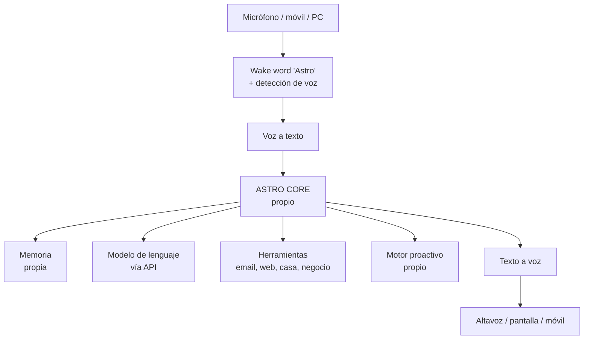

# Proyecto ASTRO — Plan de acción completo

Sep 24, 2026 · Jhony Wilker

## Visión

ASTRO es un asistente personal propio, inspirado en el JARVIS de Iron Man: se activa al oír su nombre, conversa de forma natural, recuerda, ve, controla la casa, se adelanta a los problemas y, más adelante, supervisa Brigantium Playa. Lo construye Jhony con ayuda de IA, fase a fase, empezando por lo personal y expandiendo al negocio.

**Qué lo diferencia de Siri o Google Assistant**

- Conversación continua, con contexto y memoria de semanas y meses, no orden → respuesta.
- Razona y encadena acciones: busca, compara, prepara y ejecuta con permiso.
- Proactivo: habla cuando algo importa, calla cuando no.
- Entiende cuándo no le hablan a él ("no es contigo") y vuelve a dormir.
- Conoce la vida y el negocio de Jhony, no la de un usuario medio.

**Qué no es**

- No es un modelo de IA entrenado desde cero: el razonamiento lo aporta un modelo de lenguaje (LLM) contratado por API.
- No es autonomía total: ASTRO propone y ejecuta dentro de permisos definidos por Jhony.

**Principios de diseño**

1. **El cerebro es propio.** Núcleo, memoria, contexto, personalidad y decisiones se programan desde cero.
2. **Las piezas se reutilizan.** Modelo de lenguaje, voz a texto, texto a voz y control de dispositivos son componentes intercambiables.
3. **Cada fase termina funcionando.** Nada queda a medias antes de abrir la siguiente.
4. **Software calcula, IA interpreta.** Cifras de negocio siempre salen de funciones deterministas.
5. **Seguridad desde el día 1.** Todo contenido externo (emails, webs) es dato, nunca instrucción.
6. **Gasto mínimo.** Bloques 0–4 sin hardware nuevo: el PC actual, la API y un VPS pequeño, todo con límite de gasto mensual. El equipo de casa llega en el bloque 5.

## Cómo usar este plan

El plan tiene 160 fases en 12 bloques, más subfases (9a, 22a…). Se ejecutan en orden, una a una: "vamos a hacer la fase 23" es la unidad de trabajo.

**Estructura de cada fase al ejecutarla**

1. **Objetivo:** qué funciona al terminar.
2. **Qué se aprende:** el concepto de programación o técnico nuevo.
3. **Pasos:** código escrito juntos, explicado línea a línea.
4. **Prueba:** cómo se comprueba que funciona.
5. **Criterio de salida:** condición exacta para darla por terminada.
6. **Registro:** una entrada en `docs/log.md` con qué se hizo, qué falló y qué se decidió.

**Reglas de avance**

- Una fase no se cierra si su prueba no pasa.
- Cada bloque termina con una **puerta (gate)**: una demo que debe funcionar antes de abrir el bloque siguiente.
- Si una fase se atasca más de 3 sesiones, se divide en subfases (23a, 23b…).
- Ideas nuevas van al final del bloque que corresponda, nunca se cuelan en la fase actual.

**Cómo trabajar con una IA o una persona**

Al empezar cada sesión, se le pasa:

1. Este documento.
2. El número de fase actual.
3. Las últimas entradas de `docs/log.md`.
4. El código relevante o el enlace al repositorio.

Frase de arranque: *"Soy Jhony, programo a nivel básico. Estamos construyendo ASTRO según este plan. Vamos con la fase N. Explícame cada paso y escribamos el código juntos."*

**Ritmo estimado**

A 8–10 horas por semana, los bloques 0–4 (asistente de voz con memoria y herramientas) llevan unos 5–6 meses. El plan completo, unos 18–24 meses. Son estimaciones: la temporada de verano en Brigantium frenará el ritmo y conviene planificarlo así.

## Arquitectura y stack

El núcleo de ASTRO es un programa propio en Python que vive en un VPS en la UE, disponible 24/7. En casa, un mini-PC hace de oídos, ojos y manos (micrófonos, cámaras, Home Assistant) y solo envía texto y eventos al cerebro. Si la casa se queda sin luz o sin internet, ASTRO sigue en el móvil y avisa. Todo lo demás son piezas que el núcleo usa y que se pueden cambiar sin rehacer el sistema.



El flujo va de arriba abajo: ASTRO oye su nombre, transcribe, el núcleo decide con memoria y herramientas, y responde por el canal adecuado.

| Pieza | Elección inicial | Por qué | Se construye o se reutiliza |
| --- | --- | --- | --- |
| Lenguaje | Python | Sencillo para aprender, domina en IA | — |
| Núcleo, memoria, contexto, proactividad | Código propio | Es lo que hace a ASTRO único | Se construye |
| Modelo de lenguaje | ChatGPT vía API, con capa propia para cambiar de modelo | Razonamiento mediante un servicio externo sin mantener servidores de IA | Se reutiliza |
| Voz a texto | faster-whisper (local) | Gratis, privado, buen español | Se reutiliza |
| Texto a voz | ElevenLabs (modelo Flash) como voz principal; Piper local de respaldo y para frases cortas | La mejor voz disponible, y sigue hablando si falla la nube | Se reutiliza |
| Wake word | openWakeWord con modelo entrenado para "Astro" | Permite palabra propia, sin "hey" | Se entrena |
| Detección de voz | Silero VAD | Saber cuándo empiezas y terminas de hablar | Se reutiliza |
| Base de datos | SQLite → PostgreSQL + pgvector | Empezar simple, escalar cuando haga falta | Se reutiliza |
| API y conexión de dispositivos | FastAPI + WebSocket | Estándar en Python | Se reutiliza |
| Dispositivos de casa | Home Assistant, solo como capa de control | Evita programar cada marca de bombilla | Se reutiliza |
| Cámaras | Frigate | Detección local de personas y objetos | Se reutiliza |
| Acceso remoto | Tailscale | Acceso seguro sin abrir puertos | Se reutiliza |
| Código y versiones | Git + GitHub privado | Historial y copia de seguridad del código | — |
| Pruebas | pytest | Comprobar que nada se rompe | — |
| Servidor del cerebro | VPS Linux en la UE (Ubuntu Server LTS), solo accesible por Tailscale | ASTRO 24/7 y aviso si la casa cae | Se reutiliza |
| Equipo de casa | Mini-PC Intel con gráfica integrada, Ubuntu Server LTS + Docker | Cámaras, micrófonos y casa en local; el portátil queda libre | Se reutiliza |

**Estructura de carpetas**

```
astro/
├── core/        cerebro: bucle principal, contexto, decisiones
├── voice/       wake word, voz a texto, texto a voz
├── memory/      base de datos y recuerdos
├── tools/       herramientas (web, email, casa, negocio)
├── proactive/   eventos, reglas, atención
├── clients/     móvil, PC, nodos de habitación
├── config/      configuración y personalidad
├── tests/       pruebas automáticas
└── docs/        este plan, log.md, decisiones
```

## Bloque 0 — Preparación y fundamentos (fases 1–10)

Objetivo: tener el entorno instalado y la base de Python suficiente para entender el código que se escribe después. Duración estimada: 2–3 semanas.

| Fase | Qué se hace | Criterio de salida |
| --- | --- | --- |
| 1 | ✅ Definir ASTRO 0.1 en una página: qué hará y qué no | `docs/vision.md` escrito |
| 2 | ✅ Inventario: PC, sistema operativo, móvil, red, dispositivos de casa | Lista en `docs/inventario.md` |
| 3 | ✅ Instalar Python, VS Code y Git | `python --version` y `git --version` responden |
| 4 | ✅ Crear cuenta de GitHub y repositorio privado `astro` | Primer commit subido |
| 5 | ✅ Python I: variables, funciones, condiciones, bucles | 5 ejercicios resueltos |
| 6 | ✅ Python II: listas, diccionarios, archivos, JSON | Programa que guarda y lee un JSON |
| 7 | ✅ Entornos virtuales y paquetes (venv, pip) | `requirements.txt` funcionando |
| 8 | Cuenta en la API de OpenAI, clave en `.env`, límite de gasto mensual | Script que imprime una respuesta del modelo |
| 9 | Crear la estructura de carpetas del proyecto | Árbol de carpetas en el repositorio |
| 9a | Crear el VPS en la UE: cortafuegos, Tailscale y copias automáticas (snapshots) | VPS accesible solo por Tailscale, sin puertos abiertos |
| 10 | Crear `docs/log.md` y la rutina de sesión | Primera entrada del diario |

**Puerta del bloque 0:** un script de 10 líneas, escrito y entendido por Jhony, que envía una pregunta al modelo y muestra la respuesta.

## Bloque 1 — Cerebro en texto y app web (fases 11–22d)

Objetivo: el núcleo de ASTRO conversa por texto con personalidad propia, usa herramientas y registra coste y errores. Duración estimada: 3–4 semanas.

| Fase | Qué se hace | Criterio de salida |
| --- | --- | --- |
| 11 | Chat en terminal: pregunta → modelo → respuesta | Conversación de un turno |
| 12 | Historial: recuerda lo dicho en la misma conversación | 10 turnos coherentes |
| 13 | Personalidad de ASTRO en `config/personality.md`: tono, idioma, trato | Respuestas con estilo reconocible |
| 14 | Respuestas en streaming (palabra a palabra) | El texto aparece mientras se genera |
| 15 | Configuración central (`config.yaml`): modelo, idioma, límites | Cambiar modelo sin tocar código |
| 16 | Registro de cada petición: tokens, coste, tiempo de respuesta | Informe diario de coste |
| 17 | Manejo de errores: sin internet, API caída, reintentos | ASTRO avisa en vez de romperse |
| 18 | Primera herramienta: fecha y hora | "¿Qué día es?" responde bien |
| 19 | Segunda herramienta: calculadora | Cálculos exactos |
| 20 | Registro genérico de herramientas: nombre, descripción, parámetros, riesgo | Añadir una herramienta = un archivo |
| 21 | Bucle de agente: el modelo encadena varias herramientas | Tarea de 3 pasos resuelta sola |
| 22 | Primeras pruebas automáticas (pytest) del núcleo | 10 pruebas pasan |
| 22a | Núcleo desplegado en el VPS con FastAPI + WebSocket | Terminal y navegador hablan con el mismo ASTRO |
| 22b | Tailscale en el VPS, el PC y el iPhone | ASTRO responde desde el iPhone fuera de casa sin abrir puertos |
| 22c | App web propia (PWA): chat de texto con ASTRO, sin Telegram ni apps de terceros | Instalada en la pantalla de inicio del iPhone, conversación completa |
| 22d | App web: panel de estado y notificaciones push | Aviso de prueba recibido con la app cerrada |

Desde la 22a el cerebro vive en el VPS: programas en el PC, despliegas en el VPS y la app web funciona 24/7 con el PC apagado.

**Puerta del bloque 1:** conversación de 20 turnos coherente, uso correcto de 2 herramientas, coste de la sesión visible y la misma conversación desde la app web del iPhone fuera de casa.

## Bloque 2 — Voz (fases 23–38)

Objetivo: hablar con ASTRO diciendo solo "Astro", en conversación continua, con interrupciones y sabiendo cuándo no le hablan a él. Es el bloque que más lo separa de Siri. Duración estimada: 5–7 semanas.

| Fase | Qué se hace | Criterio de salida |
| --- | --- | --- |
| 23 | Capturar audio del micrófono y guardarlo | Archivo de audio grabado |
| 24 | Voz a texto con faster-whisper | Transcripción correcta en español |
| 25 | Texto a voz con Piper | ASTRO lee una frase en voz alta |
| 26 | Pulsar tecla → hablar → respuesta hablada | Primera conversación por voz |
| 27 | Detección de voz: saber cuándo terminas de hablar | Sin cortar ni esperar de más |
| 28 | Voz en streaming: empieza a hablar antes de terminar de pensar | Primera palabra en menos de 3 s |
| 29 | Wake word propio: entrenar el modelo para "Astro" | Se activa con "Astro", sin "hey" |
| 30 | Estados: dormido, escuchando, pensando, ejecutando, hablando | Indicador visual y sonoro de cada estado |
| 31 | Conversación continua: ventana de seguimiento sin repetir "Astro" | 5 intercambios seguidos sin nombrarlo |
| 32 | "No es contigo": detectar si la frase iba dirigida a ASTRO y volver a dormir | Descarta frases ajenas y registra el falso positivo |
| 33 | Interrupción: hablar encima y que se calle | Se detiene en menos de 0,5 s |
| 34 | Cancelación de eco: que no se oiga a sí mismo | Sin autoactivaciones con altavoz |
| 35 | Voz propia de ASTRO: diseñarla en ElevenLabs (modelo Flash, sin clonar a ninguna persona real) y elegir plan con los datos de uso de la fase 16 | Voz configurada, con cambio automático a Piper si falla la nube |
| 36 | Optimizar latencia | Primera palabra en menos de 2 s |
| 37 | ASTRO como servicio que arranca con el PC | Disponible sin abrir nada |
| 38 | Pruebas de voz con 50 frases grabadas | 90% entendidas correctamente |

**Puerta del bloque 2:** 5 minutos de conversación natural por voz, con como máximo una activación falsa por hora de uso normal. Aquí termina **ASTRO 0.1**.

## Bloque 3 — Memoria (fases 39–52)

Objetivo: ASTRO recuerda lo importante durante meses, recupera solo lo relevante y acepta correcciones. Duración estimada: 4–5 semanas.

| Fase | Qué se hace | Criterio de salida |
| --- | --- | --- |
| 39 | Base de datos SQLite: conversaciones y mensajes | Todo queda guardado |
| 39a | Copias automáticas de la base de datos fuera del VPS + prueba de restauración | Restauración probada con datos reales |
| 40 | Memoria de trabajo: resumir conversaciones largas | Conversación de 1 hora sin perder el hilo |
| 41 | Perfil fijo de Jhony en un archivo editable | ASTRO sabe quién eres desde el arranque |
| 41a | Estudiar cómo resuelve la memoria Hermes Agent (Nous Research, código abierto) como referencia: qué recuerda, cómo resume, cómo olvida y cómo busca en conversaciones pasadas. Solo se estudia; no se integra | Entrada en `docs/decisiones.md` con qué ideas se adoptan en las fases 42–48 y cuáles no |
| 42 | Extracción de recuerdos al final de cada conversación | Hechos nuevos guardados solos |
| 43 | Tipos de recuerdo: hechos, decisiones, preferencias, procedimientos | Cada recuerdo etiquetado |
| 44 | Búsqueda por significado (embeddings) | Encuentra recuerdos sin palabras exactas |
| 45 | Recuperación: inyectar solo lo relevante en cada pregunta | Máximo 5–10 recuerdos por respuesta |
| 46 | Puntuación: importancia, recencia, frecuencia, confianza | Lo importante gana a lo reciente trivial |
| 47 | Correcciones y contradicciones ("eso ya no es así") | El dato viejo se sustituye |
| 48 | Olvidar a petición ("olvida eso") | El recuerdo desaparece |
| 49 | Referencias temporales: "seguimos con lo de ayer" | Retoma el tema correcto |
| 50 | Panel para ver y editar recuerdos | Página simple con la lista |
| 51 | Migrar a PostgreSQL + pgvector cuando crezca | Misma función, más capacidad |
| 52 | Pruebas de memoria: 30 preguntas semanas después | 90% correctas, sin recuerdos irrelevantes |

**Puerta del bloque 3:** preguntas hechas 3 semanas después recuperan la información correcta.

## Bloque 4 — Herramientas personales (fases 53–66)

Objetivo: ASTRO actúa sobre email, calendario, web y archivos, siempre dentro de permisos. Los permisos van primero porque protegen todo lo demás. Duración estimada: 4–6 semanas.

| Fase | Qué se hace | Criterio de salida |
| --- | --- | --- |
| 53 | Sistema de permisos por acción: AUTO, ASK, DENY | Cada herramienta tiene nivel asignado |
| 54 | Confirmación por voz de acciones ASK | "¿Lo envío?" → "sí" ejecuta |
| 55 | Auditoría: registro de cada acción ejecutada | Historial consultable |
| 56 | Búsqueda web | Respuestas con fuente |
| 57 | Leer páginas web completas | Resume un artículo dado |
| 58 | Calendario: leer | "¿Qué tengo mañana?" |
| 59 | Calendario: crear y mover eventos (ASK) | Evento creado tras confirmar |
| 60 | Email: leer y resumir | "¿Algo importante hoy?" |
| 61 | Email: borradores (AUTO) y envío (ASK) | Respuesta preparada y enviada con permiso |
| 62 | Tareas y recordatorios propios | "Recuérdame X el viernes" |
| 63 | Archivos locales: buscar y leer documentos y PDFs | Responde sobre un documento |
| 64 | Notas por voz ("apunta que…") | Nota guardada y recuperable |
| 65 | Tiempo, noticias y tráfico | Respuesta actualizada |
| 66 | Defensa contra instrucciones ocultas en emails y webs | Prueba con email trampa superada |

**Puerta del bloque 4:** "Astro, busca el correo de X, dime qué quiere y prepara una respuesta" funciona de principio a fin por voz.

## Bloque 5 — Casa inteligente (fases 67–78)

Objetivo: ASTRO controla y entiende el estado de la casa. Home Assistant solo hace de "manos": el cerebro que decide sigue siendo ASTRO. Aquí aparece el primer gasto en hardware, pequeño y por pasos. Duración estimada: 4–6 semanas.

| Fase | Qué se hace | Criterio de salida |
| --- | --- | --- |
| 67 | Elegir equipo de casa: mini-PC Intel con gráfica integrada, Ubuntu Server LTS + Docker, siempre encendido | Equipo instalado y conectado al VPS por Tailscale |
| 68 | Instalar Home Assistant en Docker en el equipo de casa | Panel accesible |
| 69 | Primeros 2–3 dispositivos: enchufes o bombillas | Se controlan desde el panel |
| 70 | Herramienta ASTRO → Home Assistant: listar y controlar | "Astro, apaga el salón" |
| 71 | Escenas por voz: modo noche, modo cine, salgo de casa | Escena completa con una frase |
| 72 | Clima y termostato | "Pon 21 grados" |
| 73 | Altavoces y música | Música por voz en la habitación indicada |
| 74 | Televisión | Encender y cambiar de entrada |
| 75 | Sensores: puertas, movimiento, temperatura | Estado visible para ASTRO |
| 76 | Estado de la casa como contexto del cerebro | "¿Me he dejado algo encendido?" |
| 77 | Automatizaciones propuestas por ASTRO (primero ASK) | Propone una rutina útil y la activa con permiso |
| 78 | Modo ausencia y seguridad | Aviso si se abre una puerta estando fuera |

**Puerta del bloque 5:** "Astro, me voy a dormir" deja la casa en modo noche y responde si algo quedó abierto o encendido.

## Bloque 6 — Visión y cámaras (fases 79–90)

Objetivo: ASTRO ve la pantalla, documentos y cámaras, y describe lo que pasa. La detección continua se hace en local; la descripción detallada, en la nube solo cuando hace falta, para controlar coste y privacidad. Duración estimada: 4–6 semanas.

| Fase | Qué se hace | Criterio de salida |
| --- | --- | --- |
| 79 | Capturas de pantalla: "Astro, mira esto" | Explica lo que hay en pantalla |
| 80 | Leer fotos y documentos enviados desde el móvil | Extrae datos de un ticket o factura |
| 81 | Primera cámara IP en casa | Imagen en directo accesible |
| 82 | Frigate: detección local de personas y vehículos | Eventos detectados sin nube |
| 83 | Eventos de cámara enviados a ASTRO | ASTRO sabe que alguien llegó |
| 84 | Descripción de escenas con modelo de visión | "¿Qué pasa en la entrada?" |
| 85 | Reconocimiento de caras conocidas, local y con consentimiento de quien aparece | Distingue conocidos de desconocidos |
| 86 | Búsqueda en grabaciones | "¿Cuándo llegó el paquete?" |
| 87 | Cámara del móvil en directo | ASTRO comenta lo que enfocas |
| 88 | Privacidad: zonas ocultas, tiempo de conservación, cifrado | Política aplicada y documentada |
| 89 | Control de coste: qué se procesa en local y qué en la nube | Coste mensual de visión medido |
| 90 | Pruebas de visión | 20 escenas de prueba descritas correctamente |

**Puerta del bloque 6:** ASTRO avisa de quién ha llegado a casa y responde preguntas sobre lo ocurrido en las últimas 24 horas.

## Bloque 7 — Proactividad y rutinas (fases 91–102)

Objetivo: ASTRO habla por iniciativa propia cuando algo importa y calla cuando no. El reto no es que avise, sino que no moleste. Duración estimada: 4–5 semanas.

| Fase | Qué se hace | Criterio de salida |
| --- | --- | --- |
| 91 | Programador de tareas (horarios y repeticiones) | Tarea que se ejecuta sola cada mañana |
| 92 | Bus de eventos: email nuevo, calendario, sensores, cámaras | Todos los eventos llegan a un único punto |
| 93 | Reglas simples (si pasa X, haz Y) | 5 reglas activas |
| 94 | Motor de atención: importancia × urgencia × confianza | Cada aviso tiene puntuación |
| 95 | Canales: voz, notificación al móvil, pantalla o nada | El canal depende de la puntuación |
| 96 | Modos: no molestar, trabajando, durmiendo, conduciendo | Respeta el modo activo |
| 97 | Resumen de la mañana, corto | Menos de 60 segundos hablado |
| 98 | Repaso de la noche: hecho, pendiente, mañana | Automático a la hora elegida |
| 99 | Repaso semanal de proyectos y decisiones | Informe cada domingo |
| 100 | Recordatorios por contexto: lugar, persona, momento | "Recuérdamelo cuando llegue a casa" |
| 101 | Aprendizaje por feedback: "esto no me interesa" | Ajusta el umbral solo |
| 102 | Métrica de señal/ruido | Más del 80% de avisos valorados útiles |

**Puerta del bloque 7:** una semana entera de avisos donde Jhony valora útiles al menos 8 de cada 10.

## Bloque 8 — Presencia física, multi-habitación y móvil (fases 103–116)

Objetivo: un solo ASTRO accesible desde cualquier habitación, el móvil, el PC y el coche, con la conversación siguiéndote de un dispositivo a otro. Duración estimada: 6–8 semanas.

| Fase | Qué se hace | Criterio de salida |
| --- | --- | --- |
| 103 | Separar clientes: PC, iPhone y nodos hablan con el cerebro del VPS | El PC es un cliente más |
| 104 | Vigilante de casa: el VPS detecta si el equipo de casa deja de responder | Aviso al iPhone en menos de 5 min si la casa cae |
| 105 | Tailscale en el equipo de casa y los nodos de habitación | Todos los dispositivos conectados sin abrir puertos |
| 106 | App web: modo sin conexión con mensajes en cola | Lo que dices sin cobertura se envía al volver la conexión |
| 107 | Voz en la app web: hablar a ASTRO y oír la respuesta | Pregunta hablada y respuesta hablada desde el iPhone |
| 108 | App web: panel ampliado con casa, cámaras y avisos (la base es de la 22d) | Estado completo de ASTRO en el iPhone |
| 109 | Primer nodo de habitación: micrófono, altavoz y wake word en local | "Astro" funciona en otra habitación |
| 110 | Multi-habitación: responde solo el nodo más cercano | Sin respuestas dobles |
| 111 | Enrutado por contexto: PC, móvil o altavoz según dónde estés | Responde por el dispositivo correcto |
| 112 | Traspaso de conversación entre dispositivos | Empiezas en casa y sigues en el móvil |
| 113 | Identificación de voz y permisos por persona | Distingue a Jhony de otras personas de la casa |
| 114 | Coche, a través del móvil | Conversación por voz conduciendo |
| 115 | Reloj | Avisos y respuestas breves en la muñeca |
| 116 | Pantalla tipo HUD en tablet o monitor | Panel con estado, avisos y cámaras |

### App nativa para iPhone (fases 116a–116k)

Cuando la app web funcione, se construye una app propia para iPhone que sustituye a la web en el móvil y añade lo que una web no puede hacer. Requiere las fases 53–55 (permisos y auditoría): todo lo que la app haga en el iPhone pasa por AUTO, ASK o DENY.

| Fase | Qué se hace | Criterio de salida |
| --- | --- | --- |
| 116a | Elegir tecnología: Swift con un Mac (recomendado, porque la fase 151a también exige Mac) o Expo/React Native (compila en la nube desde el PC). Cuenta de Apple Developer (99 €/año) | App de prueba instalada en el iPhone por TestFlight |
| 116b | Chat y voz conectados al cerebro por WebSocket, reutilizando lo hecho en la app web | Misma conversación que en la app web |
| 116c | Notificaciones push nativas según la puntuación del motor de atención | Avisos con la app cerrada, respetando los modos |
| 116d | Siri y Atajos (App Intents): llamar a ASTRO desde Siri | Una pregunta a ASTRO desde Siri sin abrir la app |
| 116e | Acciones del iPhone desde la app: calendario, recordatorios, contactos, preparar mensajes y llamadas | 5 acciones pedidas por voz; mensajes y llamadas con la confirmación de iOS |
| 116f | Contexto del iPhone para el cerebro: ubicación, batería, actividad (con permiso) | "Recuérdamelo cuando llegue a casa" usa la ubicación real |
| 116g | Automatizaciones de Atajos que avisan a ASTRO: llegar a casa, alarma, conectar al coche | 3 automatizaciones activas |
| 116h | Widgets y pantalla de bloqueo con el estado de ASTRO | Estado visible sin abrir la app |
| 116i | Pruebas: 30 peticiones reales desde el iPhone | 90% resueltas correctamente |
| 116j | "Astro, mira esto" en el iPhone: Atajo que hace captura de pantalla y la envía a ASTRO, lanzado con Siri o con doble toque en la parte trasera | Explica lo que hay en pantalla en cualquier app |
| 116k | Pantalla en directo: extensión de emisión (ReplayKit) que envía la pantalla a ASTRO mientras la activas desde el Centro de control | ASTRO comenta en tiempo real lo que haces en el iPhone |

Qué permite iOS: leer la pantalla con capturas (116j) y en directo (116k), y controlarla con WebDriverAgent desde un Mac (151a). iPhone Mirroring no sirve: Apple lo mantiene desactivado en la UE.

**Puerta del bloque 8:** una conversación que empieza en el salón, sigue en el coche y termina en el móvil sin repetir contexto, y la app de iPhone ejecuta 3 acciones del móvil pedidas por voz.

## Bloque 9 — Brigantium (fases 117–134)

Objetivo: ASTRO conoce el restaurante con datos reales y detecta problemas que Jhony no le ha señalado. Todas las cifras salen de funciones programadas; la IA solo las interpreta. Duración estimada: 8–10 semanas, idealmente en temporada baja.

| Fase | Qué se hace | Criterio de salida |
| --- | --- | --- |
| 117 | Inventario de datos: qué exporta el TPV, dónde están compras, escandallos y horas | Mapa de fuentes de datos |
| 118 | Base de datos del restaurante: ventas, productos, recetas, compras, personal, caja | Tablas creadas |
| 119 | Importar ventas del TPV | Ventas de ayer cargadas automáticamente |
| 120 | Carta y productos | Carta completa en la base de datos |
| 121 | Escandallos: ingredientes, gramajes, mermas, PVP | Coste teórico por plato |
| 122 | Compras y proveedores | Histórico de precios por proveedor |
| 123 | Personal y horas trabajadas | Coste de personal por día |
| 124 | Motor financiero: food cost, margen, coste laboral, punto de equilibrio | Funciones con pruebas automáticas |
| 125 | Herramientas para ASTRO: "¿Cómo fue ayer?" | Ventas + margen + personal + anomalías |
| 126 | Ingeniería de menú: popularidad × margen | Clasificación de cada plato |
| 127 | Alertas de subida de precios de compra | Aviso cuando un ingrediente sube más de lo normal |
| 128 | Mermas: consumo teórico vs real | Desviación por ingrediente |
| 129 | Productividad del personal: ventas por hora trabajada | Informe por turno |
| 130 | Previsión de ventas: histórico, calendario, tiempo | Previsión a 7 días |
| 131 | Caja proyectada a 7, 30 y 90 días | Aviso si no cubre pagos previstos |
| 132 | Informe semanal automático del negocio | Cada lunes por la mañana |
| 133 | Nodo de voz en la oficina del restaurante | ASTRO disponible en el local |
| 134 | Cámaras en el restaurante solo con cumplimiento del RGPD: finalidad, información a la plantilla, carteles | Revisión legal hecha antes de instalar |

**Puerta del bloque 9:** ASTRO detecta al menos un problema de coste real que Jhony no le había señalado.

## Bloque 10 — Seguridad, fiabilidad y evaluación (fases 135–148)

Objetivo: auditar y endurecer todo lo construido. La seguridad básica empieza en la fase 8 (claves en `.env`) y la 53 (permisos); este bloque la completa antes de dar más autonomía. Duración estimada: 5–6 semanas.

| Fase | Qué se hace | Criterio de salida |
| --- | --- | --- |
| 135 | Gestión de secretos: claves fuera del código y cifradas | Ninguna clave en el repositorio |
| 136 | Autenticación de cada dispositivo cliente | Un dispositivo desconocido no entra |
| 137 | Cifrado de datos en tránsito y en reposo | Base de datos y conexiones cifradas |
| 138 | Copias de seguridad automáticas + prueba de restauración | Restauración completa probada |
| 139 | Monitorización: aviso si ASTRO o una pieza cae | Alerta al móvil en menos de 5 min |
| 140 | Actualizaciones controladas con vuelta atrás | Actualizar sin miedo a romperlo |
| 141 | Red separada para dispositivos de casa | IoT aislado del resto |
| 142 | Batería de ataques de inyección por email y web | Ningún ataque ejecuta acciones |
| 143 | Límites de gasto de API y alertas | Aviso al 80% del presupuesto |
| 144 | Modo sin internet con funciones básicas | Luces y hora funcionan offline |
| 145 | Suite de evaluación: memoria, herramientas, voz, negocio, seguridad | Cientos de pruebas automáticas |
| 146 | Versiones y releases (0.1, 0.2…) | Registro de cambios por versión |
| 147 | Documentación de arquitectura al día | Otra persona entiende el sistema leyéndola |
| 148 | Revisión externa por otra IA o persona | Lista de riesgos resuelta |

**Puerta del bloque 10:** restaurar ASTRO desde cero en otro equipo a partir de las copias y la documentación.

## Bloque 11 — Avanzado: agentes, control del ordenador, producto (fases 149–160)

Objetivo: dar a ASTRO objetivos largos en vez de órdenes sueltas, y decidir si el módulo del restaurante se convierte en producto. Cada fase de este bloque se justifica con datos de uso reales antes de empezarla. Duración estimada: 3–4 meses.

| Fase | Qué se hace | Criterio de salida |
| --- | --- | --- |
| 149 | Agentes especializados, solo si un único cerebro se queda corto. Evaluar Hermes Agent como alternativa frente a construirlos desde cero | Mejora medida en la suite de evaluación |
| 150 | Orquestador que reparte y sintetiza entre agentes | Petición compleja resuelta en paralelo |
| 151 | Control del ordenador (ratón, teclado, navegador) dentro de una máquina virtual | Workflow simple completado en la VM |
| 151a | Control del iPhone con WebDriverAgent desde el Mac: leer la interfaz, pulsar, deslizar, escribir y abrir apps. Solo dentro de Tailscale y con permisos ASK | Tarea de 3 pasos completada en el iPhone tras confirmar |
| 152 | Workflows digitales completos y robustos | No se rompe con cambios pequeños de pantalla |
| 153 | Objetivos largos con aprobación por pasos ("reduce el coste de compras") | Proyecto propuesto, aprobado y ejecutado |
| 154 | Grafo de conocimiento: personas, lugares, proveedores, platos y relaciones | Una subida de precio se propaga al margen del plato |
| 155 | Modelo de lenguaje local con GPU, solo si coste o privacidad lo justifican | Comparativa coste/calidad documentada |
| 156 | Hardware avanzado: pantallas, proyección, más nodos | Según necesidades medidas |
| 157 | **ASTRO 1.0** | Todas las puertas anteriores superadas |
| 158 | Extraer el módulo del restaurante como producto independiente | Instalable fuera de Brigantium |
| 159 | 5 restaurantes piloto, casi gratis | Medido: € ahorrados, horas ahorradas, uso semanal |
| 160 | Decisión empresa: "¿pagarías X € al mes?" | Al menos 3 de 5 dispuestos a pagar, o se descarta |

**Puerta del bloque 11:** ASTRO 1.0 en uso diario y una decisión clara, con datos, sobre el producto.

## Tablero de seguimiento y glosario

Fase actual: **8 — Cuenta y API de OpenAI, clave en `.env` y límite de gasto mensual.** Actualizar esta línea y la columna Estado al cerrar cada fase.

| Bloque | Fases | Hito | Estado |
| --- | --- | --- | --- |
| 0 — Preparación | 1–10 | Primer script con el modelo | En curso |
| 1 — Cerebro en texto y app web | 11–22d | Conversación con herramientas, también desde el iPhone | Pendiente |
| 2 — Voz | 23–38 | ASTRO 0.1 por voz | Pendiente |
| 3 — Memoria | 39–52 | Recuerda durante semanas | Pendiente |
| 4 — Herramientas personales | 53–66 | Email y calendario por voz | Pendiente |
| 5 — Casa | 67–78 | Control de la casa | Pendiente |
| 6 — Visión | 79–90 | Ve y describe cámaras | Pendiente |
| 7 — Proactividad | 91–102 | Avisos útiles sin ruido | Pendiente |
| 8 — Presencia | 103–116k | En todas partes | Pendiente |
| 9 — Brigantium | 117–134 | Detecta problemas de negocio | Pendiente |
| 10 — Seguridad | 135–148 | Sistema auditado | Pendiente |
| 11 — Avanzado | 149–160 | ASTRO 1.0 y decisión de producto | Pendiente |

**Glosario**

| Término | Significado |
| --- | --- |
| LLM | Modelo de lenguaje: la pieza que razona y redacta (en ASTRO, ChatGPT) |
| API | Forma en que un programa usa un servicio de otro por internet |
| VPS | Servidor privado virtual: un ordenador en la nube, siempre encendido |
| Voz a texto (STT) | Convierte lo que dices en texto |
| Texto a voz (TTS) | Convierte el texto de ASTRO en voz |
| Wake word | Palabra que activa a ASTRO: "Astro" |
| VAD | Detección de cuándo alguien está hablando |
| Embeddings | Números que representan el significado de un texto; permiten buscar por sentido |
| Tool use | Capacidad del modelo de usar herramientas (buscar, leer email, encender luces) |
| Home Assistant | Software que controla dispositivos de casa de muchas marcas |
| Frigate | Software que detecta personas y objetos en cámaras, en local |
| RTSP | Protocolo con el que las cámaras IP envían vídeo |
| PWA | App web que se instala en la pantalla de inicio del móvil |
| Gate / puerta | Demo que debe funcionar para pasar al bloque siguiente |
